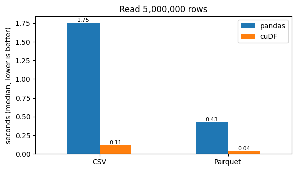
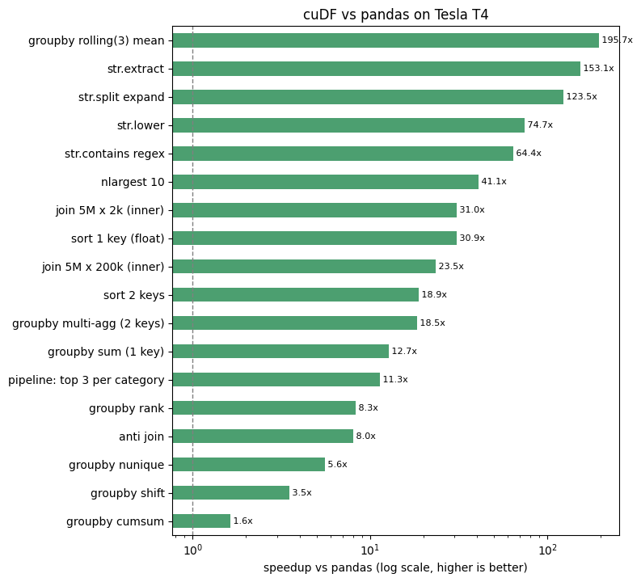
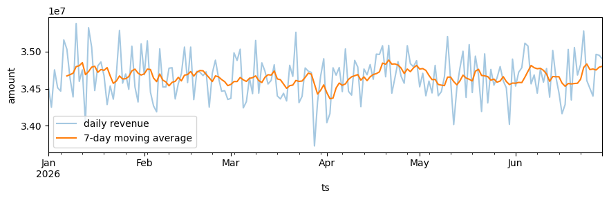
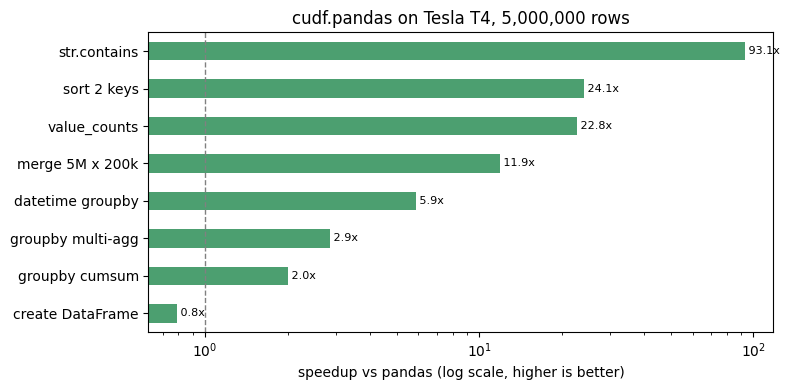
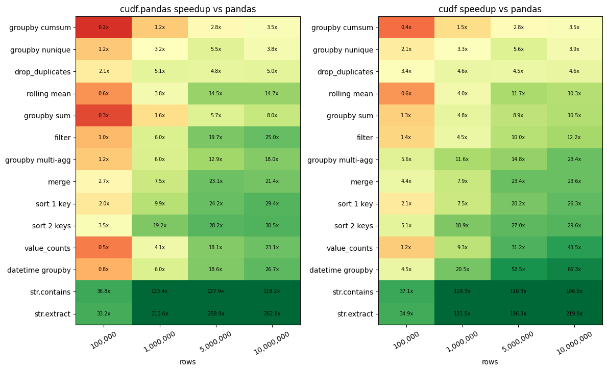
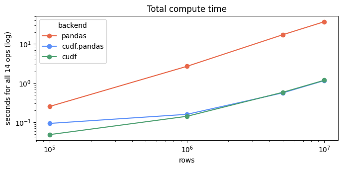
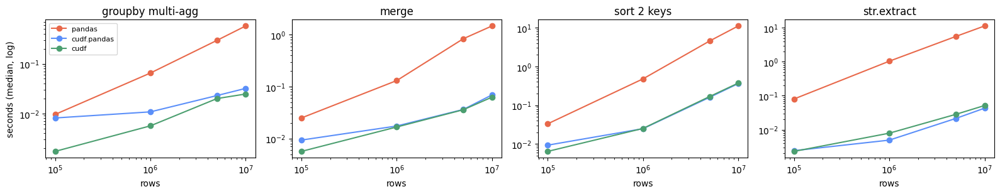
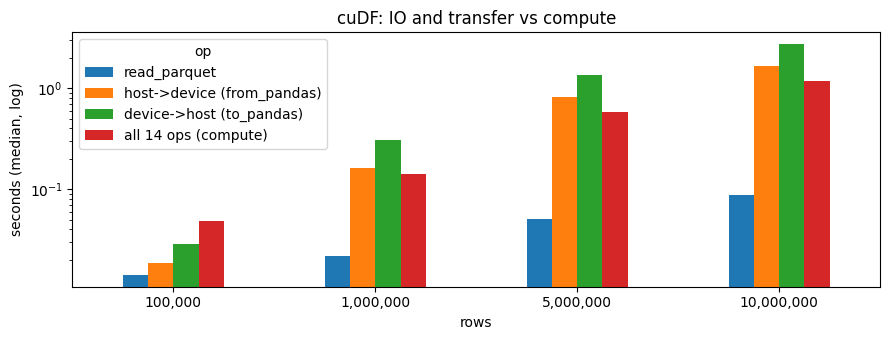

# 01_cuDF — GPU DataFrames

The four notebooks in this folder cover cuDF, a GPU DataFrame library with a pandas-like API. They go from the basics to a benchmark of pandas, `cudf.pandas` and native cuDF. Every number on this page was measured on the setup below; the outputs are saved in the notebooks.

## Setup

| | |
|---|---|
| Platform | Google Colab, used through the Colab kernel in VS Code |
| GPU | NVIDIA Tesla T4, 15.6 GB, compute capability 7.5 (Turing) |
| Driver / CUDA | 580.82.07 / CUDA 13.0 |
| CPU / RAM | Intel Xeon @ 2.00 GHz, **2 cores** / 13.3 GB |
| Software | Python 3.13.16, cuDF 26.06.00, CuPy 14.0.1, pandas 2.2.3, NumPy 2.1.3 |

cuDF comes preinstalled on Colab GPU runtimes. Elsewhere, install it with:

```bash
pip install cudf-cu12 --extra-index-url=https://pypi.nvidia.com
```

> The pandas baseline ran on only 2 CPU cores, which is Colab's default. On a large server CPU, pandas would be faster and the GPU speedups smaller. The relative patterns (which operations gain most, where the GPU stops paying off) still hold.

## Notebooks

| # | Notebook | What it covers |
|---|---|---|
| 01 | [01_cudf_basics.ipynb](01_cudf_basics.ipynb) | `Series` and `DataFrame`, selection, pandas/CuPy conversion, dtypes (nulls, strings, categoricals, datetimes, lists, structs), CSV and Parquet IO, GPU memory, cost of host↔device copies |
| 02 | [02_cudf_operations.ipynb](02_cudf_operations.ipynb) | groupby, joins (including `leftsemi` and `leftanti`), sorting, regex string operations, window functions (`cumsum`, `shift`, `rank`, `rolling`), one pipeline run unchanged on pandas and cuDF |
| 03 | [03_cudf_pandas_accelerator.ipynb](03_cudf_pandas_accelerator.ipynb) | `cudf.pandas`: unchanged pandas code on the GPU, the profilers, CPU fallback, working with other libraries, the same script run with and without acceleration |
| 04 | [04_benchmark_cudf_vs_pandas.ipynb](04_benchmark_cudf_vs_pandas.ipynb) | Benchmark of pandas, `cudf.pandas` and cuDF on 14 operations, from 100k to 10M rows |

---

## 01 — Basics

**Reading 5M rows**

| Format | Size | pandas | cuDF | Speedup |
|---|---|---|---|---|
| CSV | 141 MB | 1.753 s | 0.113 s | **15.5×** |
| Parquet | 72 MB | 0.427 s | 0.037 s | **11.6×** |



**Memory and transfer**

| Measurement | Result |
|---|---|
| `category` column: strings → categorical | 49 MB → **5 MB** |
| Whole frame after downcasting (`int64`→`int32`, `float64`→`float32`) | 105 MB → **65 MB** |
| GPU memory used before / after `del` + `gc.collect()` | 0.55 GB → 0.41 GB (CUDA context and memory caches remain) |
| Copy 5M rows CPU → GPU | 370 ms |
| Copy 5M rows GPU → CPU | 639 ms |
| `sum()` of one column on GPU / CPU | **0.8 ms** / 6.1 ms |

**Key findings**
- One copy to the GPU (370 ms) costs about 460 times as long as the GPU `sum()` it enables (0.8 ms). Load data straight onto the GPU and keep it there.
- In cuDF every column can hold nulls. An int column with a missing value stays `int64` (`[1, 2, <NA>]`), where pandas turns it into `float64` (`[1.0, 2.0, NaN]`).
- **Differences from pandas found while running:**
  - `DataFrame.query()` only works on numeric, datetime, timedelta and bool columns. Filter strings with a boolean mask instead.
  - `cudf.Series.from_pandas` no longer exists in 26.x. Use `cudf.from_pandas(...)`.
  - Building a Series from data that contains NaN already turns the NaN into a null. NaN is a float value and null means "missing"; `.nans_to_nulls()` converts the first into the second.

---

## 02 — Operations (5M orders × 200k customers × 2k products)

| Operation | pandas | cuDF | Speedup |
|---|---|---|---|
| groupby rolling(3) mean | 7,304 ms | 37 ms | **196×** |
| str.extract | 6,704 ms | 44 ms | **153×** |
| str.split (expand) | 8,318 ms | 67 ms | **124×** |
| str.lower | 874 ms | 12 ms | 75× |
| str.contains (regex) | 2,592 ms | 40 ms | 64× |
| nlargest 10 | 1,409 ms | 34 ms | 41× |
| join 5M × 2k | 1,504 ms | 49 ms | 31× |
| sort 1 key | 3,905 ms | 126 ms | 31× |
| join 5M × 200k | 1,209 ms | 52 ms | 24× |
| sort 2 keys | 3,985 ms | 211 ms | 19× |
| groupby multi-agg | 347 ms | 19 ms | 19× |
| groupby sum | 103 ms | 8 ms | 13× |
| pipeline: top 3 per category | 404 ms | 36 ms | 11× |
| groupby rank | 1,857 ms | 225 ms | 8.3× |
| anti join | 27 ms | 3 ms | 8.0× |
| groupby nunique | 728 ms | 131 ms | 5.6× |
| groupby shift | 96 ms | 27 ms | 3.5× |
| groupby cumsum | 48 ms | 30 ms | 1.6× |



**Key findings**
- **String operations and grouped rolling windows gain the most (64–196×).** pandas handles these one Python object at a time; cuDF runs them in parallel on the GPU.
- **Operations that are already cheap gain least** (`cumsum` 1.6×, `shift` 3.5×). There isn't enough work to keep the GPU busy.
- Results matched pandas in both correctness checks (`groupby` sum, and the top-3 pipeline).
- GPU joins don't keep row order. Sort the result if order matters.



---

## 03 — `cudf.pandas` (no code changes)

**The profiler.** `%%cudf.pandas.profile` ran 9 operations on the GPU in 0.08 s. One `Series.apply(lambda ...)` fell back to the CPU and took 0.95 s on its own, and the profiler listed it under "required CPU fallback". The cell with `.map(lambda ...)` took 2.95 s for the same reason, while rounding the column on the GPU took 13 ms.

**The same script, run with and without `python -m cudf.pandas` (5M rows)**

| Step | pandas | cudf.pandas | Speedup |
|---|---|---|---|
| str.contains | 2.041 s | 0.022 s | **93×** |
| sort 2 keys | 4.800 s | 0.199 s | 24× |
| value_counts | 0.545 s | 0.024 s | 23× |
| merge 5M × 200k | 0.908 s | 0.077 s | 12× |
| datetime groupby | 0.290 s | 0.049 s | 5.9× |
| groupby multi-agg | 0.770 s | 0.269 s | 2.9× |
| groupby cumsum | 0.106 s | 0.053 s | 2.0× |
| create DataFrame (from NumPy) | 1.257 s | 1.593 s | **0.8× (slower)** |
| **Whole script, including start-up** | **11.6 s** | **6.5 s** | **1.8×** |



**Key findings**
- **Creating the DataFrame was slower** because the data was built with NumPy on the CPU and then copied to the GPU.
- **The whole script was only 1.8× faster**, even though most steps were 3–93× faster. Python start-up, CUDA start-up and that copy make up most of the remaining time. Reading from Parquet would cut it.
- `type(df)` still prints `pandas.core.frame.DataFrame`. The proxy uses pandas' own class name on purpose, so `isinstance` checks keep working. `to_numpy()` returns a proxy array (`cudf.pandas._wrappers.numpy.ndarray`).
- Load the extension with `%load_ext cudf.pandas` **before** `import pandas`, in a fresh kernel.

---

## 04 — Benchmark: pandas vs `cudf.pandas` vs cuDF

**Method**
- Each backend runs in its own fresh Python process for each data size.
- Every timing is the median of 3 runs after 1 warmup run, with the GPU synced before each timer stops.
- IO, host↔device copies and compute are timed separately.
- The operation code is identical for all backends.
- In total there are 188 measurements.

### Speedup at 10M rows

| Operation | pandas | cudf.pandas | cuDF |
|---|---|---|---|
| str.extract | 11.33 s | **263×** | 220× |
| str.contains | 5.04 s | 118× | 107× |
| datetime groupby | 0.53 s | 27× | **66×** |
| value_counts | 0.50 s | 23× | **44×** |
| sort 2 keys | 11.03 s | 30× | 30× |
| sort 1 key | 4.20 s | 29× | 26× |
| merge | 1.48 s | 21× | 24× |
| groupby multi-agg | 0.58 s | 18× | 23× |
| filter | 0.38 s | 25× | 12× |
| groupby sum | 0.17 s | 8.0× | 10.5× |
| rolling mean | 0.26 s | 15× | 10× |
| drop_duplicates | 0.09 s | 5.0× | 4.6× |
| groupby nunique | 1.15 s | 3.8× | 3.9× |
| groupby cumsum | 0.21 s | 3.5× | 3.5× |


### Speedup by data size

At **100k rows**, several cheap operations are **slower on the GPU** (red cells). The fixed cost of launching GPU kernels outweighs the small amount of work. From 1M rows up, every operation is faster on the GPU.



| Below 1× at 100k rows | cudf.pandas | cuDF |
|---|---|---|
| groupby cumsum | 0.2× | 0.4× |
| groupby sum | 0.3× | 1.3× |
| value_counts | 0.5× | 1.2× |
| rolling mean | 0.6× | 0.6× |
| datetime groupby | 0.8× | 4.5× |

### Total time for all 14 operations

| Rows | pandas | cudf.pandas | cuDF | cuDF speedup |
|---|---|---|---|---|
| 100k | 0.255 s | 0.094 s | 0.049 s | 5× |
| 1M | 2.692 s | 0.160 s | 0.142 s | 19× |
| 5M | 17.254 s | 0.567 s | 0.585 s | 29× |
| 10M | **36.947 s** | **1.164 s** | **1.184 s** | **31×** |





### IO and copies vs compute (native cuDF)

| Rows | read_parquet | CPU → GPU (`from_pandas`) | GPU → CPU (`to_pandas`) | All 14 ops |
|---|---|---|---|---|
| 100k | 0.014 s | 0.019 s | 0.029 s | 0.049 s |
| 1M | 0.022 s | 0.162 s | 0.304 s | 0.143 s |
| 5M | 0.051 s | 0.813 s | 1.354 s | 0.586 s |
| 10M | **0.088 s** | 1.670 s | **2.753 s** | 1.184 s |



---

## Overall takeaways

1. **The GPU pays off from about 1M rows.** Total time for all 14 operations went from 5× faster at 100k rows to 31× at 10M. Below about 100k rows, cheap operations can be slower than pandas.
2. **Strings gain the most.** `str.extract` and `str.contains` were 100–260× faster, and `str.split` 124×.
3. **Moving data costs more than computing on it.** At 10M rows, `to_pandas()` took 2.75 s while all 14 operations took 1.18 s. Reading Parquet straight onto the GPU took 0.09 s. Load data on the GPU, keep it there, and bring back only small results.
4. **`cudf.pandas` matched native cuDF** (1.16 s vs 1.18 s at 10M) when every operation ran on the GPU. It slows down when an operation falls back to the CPU, usually because of Python `apply` or `map` lambdas. Use `%%cudf.pandas.profile` to find them.
5. **Simple per-group operations gain least** (`cumsum`, `nunique`, `shift`: 2–4×). Sorts, joins, regex and datetime groupbys gain most.
6. **Memory:** categoricals cut a string column by 10× and downcasting saved about 40%. Both let a 16 GB T4 hold more data.
