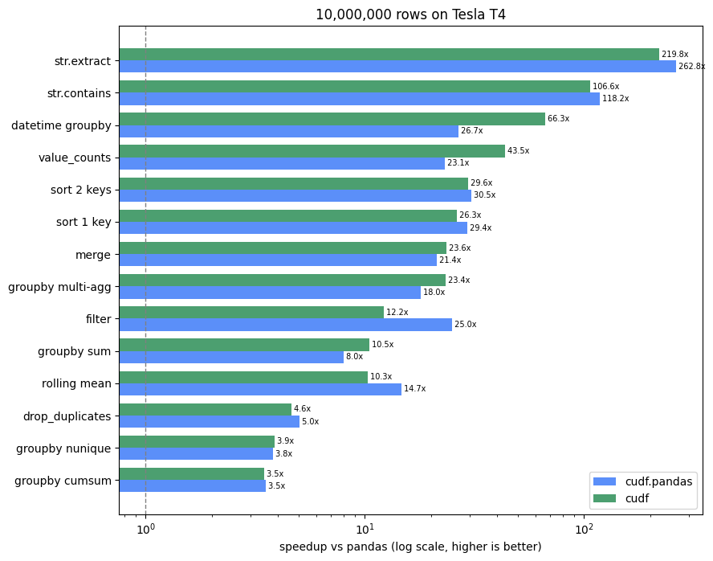

# cuda-rapids

Learning NVIDIA RAPIDS one notebook at a time. Every notebook is self-contained: setup, data, timing and plots are all inline.

**Target hardware:** NVIDIA T4 (16 GB, Turing / sm_75) on Google Colab. AMD/ROCm versions are out of scope for now.

## Progress

| Folder | Topic | Status |
|---|---|---|
| [01_cuDF](rapids/01_cuDF/README.md) | GPU DataFrames, `cudf.pandas` | ✅ Done: 4 notebooks run on T4, [findings](rapids/01_cuDF/README.md) |
| 02_cuVS | Multimodal RAG with cuVS: local EmbeddingGemma 2 (vLLM) over text, image, audio, video | 🚧 In progress |
| 03_cuGraph | Graph analytics, nx-cugraph | — |
| 04_cuML | GPU machine learning, `cuml.accel` | — |
| 05_RMM_Dask | Memory pools, Dask-cuDF | — |
| 06_cuCIM | GPU image processing | — |

## Headline results so far (Tesla T4 vs 2-core Colab CPU)

All 14 DataFrame operations at **10M rows**, run on the same data:

| Backend | Time | Speedup |
|---|---|---|
| pandas | 36.9 s | 1× |
| `cudf.pandas` (no code changes) | 1.16 s | **32×** |
| cuDF (native) | 1.18 s | **31×** |



See [rapids/01_cuDF/README.md](rapids/01_cuDF/README.md) for the full setup, every benchmark table and the takeaways.

## Layout

```
rapids/
├── 01_cuDF/       # GPU DataFrames, cudf.pandas
├── 02_cuVS/       # Multimodal vector search + RAG: EmbeddingGemma 2, IVF, CAGRA
├── 03_cuGraph/    # Graph analytics, nx-cugraph
├── 04_cuML/       # GPU machine learning, cuml.accel
├── 05_RMM_Dask/   # Memory pools, Dask-cuDF
└── 06_cuCIM/      # GPU image processing
```

## Benchmark conventions

- Warmup runs, then the median of several repeats
- GPU synchronized before each timer stops
- Host↔device transfer time reported separately from compute
- GPU model and library versions logged in the first cell
- Each backend runs in its own process when isolation matters
